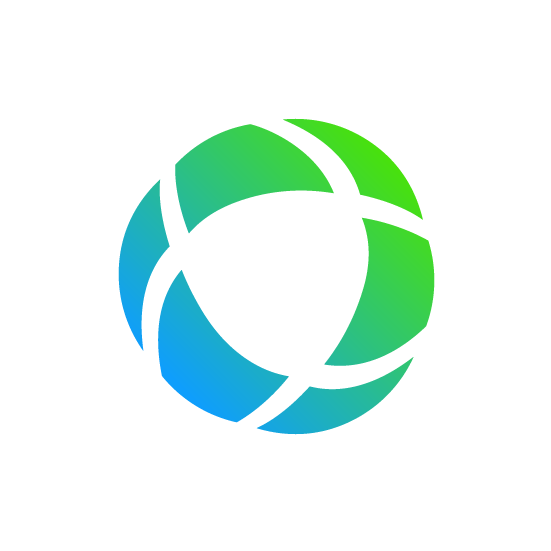

<p align="center">
  <a href="https://www.controltheory.com">
    
  </a>
</p>

# Welcome to ControlTheory

ControlTheory builds **[Dstl8](https://github.com/control-theory/dstl8)**, the telemetry-native AI SRE: the AI SRE that doesn't need an observability platform. We also created **[Gonzo](https://github.com/control-theory/gonzo)**, the open-source terminal UI for real-time log analysis.

What we build is:

- **Telemetry-native**: Telemetry Distillation analyzes every log, metric, and trace at the source and keeps what matters
- **OpenTelemetry-based**: OTLP in, nothing to replace
- **Rule-free**: Möbius, our own fine-tuned model, investigates every incident with zero alert rules
- **In the flow**: root cause and the fix in Slack, Claude Code, Cursor, Codex, and the terminal
- **Immediately useful**: one command to set up, no integration project

---

## Repositories

- [**dstl8**](https://github.com/control-theory/dstl8): Dstl8 CLI, TUI, and MCP server
- [**gonzo**](https://github.com/control-theory/gonzo): the open-source log analysis TUI
- [**gonzo-guides**](https://github.com/control-theory/gonzo/tree/main/guides): Gonzo custom log formats, skins, and integrations
- [**gonzo-custom-formats**](https://github.com/control-theory/gonzo/tree/main/formats): try your favorite log format with Gonzo
- [**gonzo-custom-skins**](https://github.com/control-theory/gonzo/tree/main/skins): 11+ themes including Dracula, Nord, Monokai, and GitHub Light

---

## Getting Started

**Dstl8** (14-day free trial, no card required):

```bash
brew install control-theory/dstl8/dstl8
dstl8 setup   # account, sources, AI agent, dashboard
```

**Gonzo** (free, MIT licensed):

```bash
brew install gonzo
gonzo --help
```

☸️ Or run Gonzo directly against your Kubernetes logs with kubectl, k9s, Stern, or Loki.
➡️ [See usage guides](https://github.com/control-theory/gonzo/tree/main/guides) and [k9s integration](https://github.com/control-theory/gonzo/tree/main#k9s-integration)

---

## Contributing

We ❤️ community input! You can help by:

- Reporting issues or feature requests in [Gonzo Issues](https://github.com/control-theory/gonzo/issues)
- Submitting PRs (see our [Contributing Guide](https://github.com/control-theory/gonzo/blob/main/CONTRIBUTING.md))

---

## Get Involved

- Join the [ControlTheory Community Slack](https://join.slack.com/t/ctrltheorycommunity/shared_invite/zt-3dr6rke5w-GlcRaW2bvn4zcSaV8byZgA)
- Start a [free 14-day Dstl8 trial](https://app.dstl8.ai/lp/dstl8-signup)
- Subscribe to our [Mailing List](https://www.controltheory.com/contact-us/)
- Follow us on [Bluesky](https://bsky.app/profile/controltheory.bsky.social), [X](https://x.com/Ctrl_Theory), and [LinkedIn](https://www.linkedin.com/company/controltheory/)

---

## Who We Are

[ControlTheory](https://www.controltheory.com) is based in Austin, Texas, and was founded by observability veterans behind StackEngine (acquired by Oracle) and CopperEgg (acquired by Idera). We believe in **open standards**, **developer-first experiences**, and **AI that shows its work**.

---

## 📜 License

All Gonzo repositories are licensed under the [MIT License](https://github.com/control-theory/gonzo/blob/main/LICENSE).
